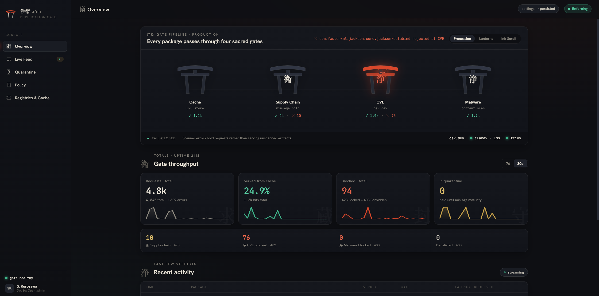
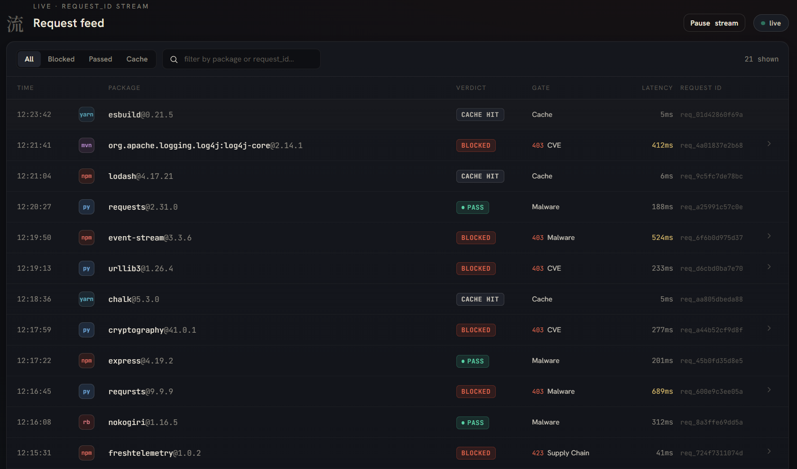
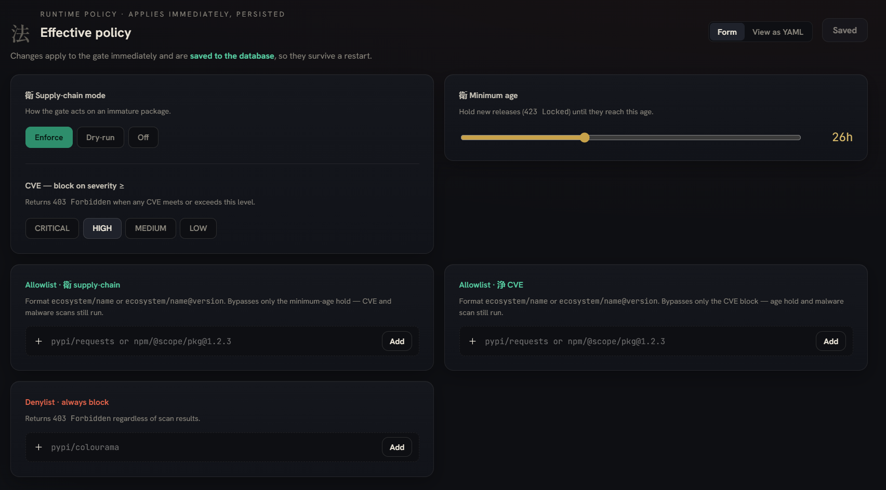
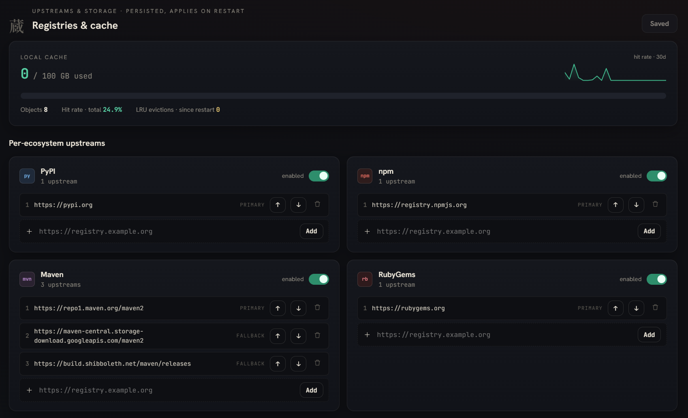

# Jōei

[](https://github.com/ggwpLab/Jo-ei/actions/workflows/ci.yml)
[](https://goreportcard.com/report/github.com/ggwpLab/Jo-ei)
[](https://pkg.go.dev/github.com/ggwpLab/Jo-ei)
[](LICENSE)

A transparent supply chain security proxy for package registries and Docker images.
Supports PyPI, npm (and Yarn), Maven, RubyGems, Go modules, and Docker Hub.
Point your package manager at Jōei instead of the upstream registry — it intercepts
every download and enforces four layers of protection before serving the artifact.
Docker images pass the same gates; for images the CVE gate is backed by Trivy,
which also scans image layers for embedded secrets.

```
Developer (pip/npm/mvn/bundle/go/docker pull)
        │
        ▼
  ┌──────────────────────────────────────────────────┐
  │                   Jōei :8080                     │
  │  1. Cache lookup (HIT served immediately)        │
  │  2. Supply Chain Filter (min package age)        │
  │  3. CVE Scanner (osv.dev; Trivy for images)      │
  │  4. Malware Scanner (ClamAV / ICAP)              │
  └──────────────────────────────────────────────────┘
        │
        ▼
   Upstream registry (PyPI / npm / Maven / RubyGems / Go / Docker Hub)
```

**What gets blocked:**
- Packages younger than the configured minimum age (`supply_chain.min_age_hours`,
  24 hours by default) — supply chain poisoning protection
- Packages with CVE severity ≥ configured threshold (`HIGH` by default) — found by
  osv.dev for packages and by Trivy for Docker images, which also reports embedded
  secrets
- Packages whose artifact matches a malware signature detected by any configured scanner
- Packages on the explicit `denylist`

**What gets cached:** Approved artifacts are stored locally; repeat requests are served
from cache without contacting the upstream registry.

## Quick Start

**Prerequisites:** Docker and Docker Compose (no Go installation required for this path).

**1. Start the proxy**

The compose file runs the released image
[`ghcr.io/ggwplab/jo-ei`](https://github.com/ggwpLab/Jo-ei/pkgs/container/jo-ei)
by default; the clone only supplies `docker-compose.yaml`, `config.yaml` and
`.env.example`.

```bash
git clone https://github.com/ggwpLab/Jo-ei.git && cd Jo-ei
```

**Optional overrides** — copy the example env file if you want to set any
`JOEI_*` variable (none is required to start):

```bash
cp .env.example .env
```

**Start the proxy and read the initial admin password.** On first start, with
an empty database, Jōei creates the console user `admin` with a random
temporary password and logs it once:

```bash
docker-compose up -d
docker-compose logs jo-ei | grep "initial admin"
```

**Prebuilt image or source build.** By default Compose pulls
`ghcr.io/ggwplab/jo-ei:latest`. For a reproducible deployment, pin a release
tag in `docker-compose.yaml` (e.g. `ghcr.io/ggwplab/jo-ei:0.5.0`) and check
out the matching tag (`git checkout v0.5.0`) so `config.yaml` fits the image.
To run your checkout instead — unreleased changes or local modifications —
build it from source:

```bash
docker-compose up -d --build
```

The source build is tagged with the same image name, so it shadows the pulled
image until you `docker-compose pull` again.

Every variable in `.env` is passed into the container, so any `JOEI_*` override
belongs there and nowhere else. `.env` is gitignored — your secrets stay out of
git. Then open the console, sign in as `admin` with the logged password and
choose a new one (the console requires it). Lost it before signing in? Run
`docker-compose exec -T jo-ei /jo-ei --config /etc/jo-ei/config.yaml reset-admin-password`
for a new one.

The proxy starts on `http://localhost:8080`. ClamAV runs as a sidecar in the compose file;
malware scanning is active when the selected policy profile sets `malware_block: true`.

**2. Point your package manager at the proxy**

pip:
```bash
pip install requests \
  --index-url http://localhost:8080/pypi/simple/ \
  --trusted-host localhost
```

Or persist it in `~/.pip/pip.conf`:
```ini
[global]
index-url = http://localhost:8080/pypi/simple/
trusted-host = localhost
```

Index pages are served with their download links rewritten to point back at
the proxy, so every file pip, uv or poetry fetches goes through the gates; an
index the proxy cannot rewrite fails with `502` rather than being passed
through.

**Maven**:
Add Jōei mirror for your repositories, configured on either project `pom.xml`:
```xml
<project>
  ...
  <repositories>
    <repository>
      <id>central</id>
      <url>http://localhost:8080/maven/</url>
    </repository>
  </repositories>

  <pluginRepositories>
    <pluginRepository>
      <id>central</id>
      <url>http://localhost:8080/maven/</url>
    </pluginRepository>
  </pluginRepositories>
</project>
```
or global level (`~/.m2/settings.xml`):
```xml
<settings xmlns="http://maven.apache.org/SETTINGS/1.2.0"
          xmlns:xsi="http://www.w3.org/2001/XMLSchema-instance"
          xsi:schemaLocation="http://maven.apache.org/SETTINGS/1.2.0
                              https://maven.apache.org/xsd/settings-1.2.0.xsd">
   <mirrors>
      <mirror>
         <id>jo-ei</id>
         <name>Jōei supply-chain proxy</name>
         <url>http://localhost:8080/maven/</url>
         <mirrorOf>central</mirrorOf>
      </mirror>
   </mirrors>
</settings>
```

**npm**:
```bash
npm install lodash --registry http://localhost:8080/npm/
```

Or persist it globally:
```bash
npm config set registry http://localhost:8080/npm/
```

**yarn** (uses the npm registry protocol via the `/yarn/` alias):
```bash
# Yarn Berry (v2+)
yarn config set npmRegistryServer http://localhost:8080/yarn/
# Yarn Classic (v1)
yarn config set registry http://localhost:8080/yarn/
```

**RubyGems / Bundler:**
```bash
# bundler
bundle config mirror.https://rubygems.org http://localhost:8080/rubygems
# or set the source in a Gemfile:
#   source "http://localhost:8080/rubygems"
```

**Go modules** (enable `registries.go.enabled: true` first):
```bash
export GOPROXY=http://localhost:8080/go
# No ",direct": a proxy miss is a 404 instead of an unscanned VCS fetch.
go mod download
```
Jōei does not proxy the checksum database (`sum.golang.org`); see
[`examples/go/`](examples/go/) for closed environments.

**Docker (registry mirror):**

Jōei can act as a pull-through proxy for Docker Hub. Point the Docker daemon at
Jōei by adding it as a registry mirror in `/etc/docker/daemon.json`:

```json
{
  "registry-mirrors": ["http://localhost:8080"]
}
```

Restart the Docker daemon, then `docker pull` fetches images through Jōei:

```bash
sudo systemctl restart docker
docker pull library/alpine:3.21
```

**Caveats:**
- Configure `upstreams` as ordered failover mirrors of *one* registry (e.g.
  Docker Hub plus a corporate pull-through mirror of it). Mixing different
  registries in one list is not supported — the Trivy image reference is built
  from the first upstream's host. Note that the Docker daemon applies
  `registry-mirrors` only to Docker Hub images; images from another upstream
  registry must be pulled explicitly as `docker pull <proxy-host>/<repo>:<tag>`.
- Images pass the same gates as packages: the min-age rule (dated by the image
  config's `created` timestamp), the CVE gate — whose engine for images is
  Trivy, scanning for vulnerabilities and embedded secrets under the same
  severity threshold and denylist as packages — and every configured malware
  engine in `malware.scanners[]` (ClamAV and/or ICAP), which scan the image
  config blob and each layer. The verdict is returned on the
  **manifest** request, so a rejected image is never served to the client.
- Enable the Docker registry in `config.yaml` by setting
  `registries.docker.enabled: true` and `image_scan.enabled: true`.

**3. Smoke test**

```bash
# Health check
curl -s http://localhost:8080/health
# Expected: {"status":"ok"}

# Install a well-known package (should pass)
pip install requests==2.31.0 --index-url http://localhost:8080/pypi/simple/ --trusted-host localhost
```

## Admin Console

Jōei ships an embedded admin console — 浄衛 *The Purification Gate* — served at
[`http://localhost:8080/console/`](http://localhost:8080/console/). It is a single-page
app baked into the binary (no extra files at runtime), and renders the four-gate
pipeline (Cache → 衛 Supply Chain → 浄 CVE → 浄 Malware) along with an overview dashboard,
a live request feed, the min-age quarantine queue, a threat-detail drawer, a policy editor,
and a registries & cache view.

The console reads live proxy state via the JSON API described below. React and the
console UI are compiled to a single bundle baked into the binary — it needs no CDN
and works fully offline.

The console signs in with the same operator credentials at `/console/`; a
session lasts 15 minutes and silently refreshes for up to 7 days of activity.



| Live request feed | Policy editor | Registries & cache |
|---|---|---|
| [](docs/images/console-requests.png) | [](docs/images/console-policy.png) | [](docs/images/console-registries.png) |

### Admin console & API

The embedded console at `/console/` shows live proxy state and lets you edit
the effective policy at runtime. It is backed by a JSON API under `/api/`:

| Endpoint | Method | Description |
|---|---|---|
| `/api/overview` | GET | KPIs, per-gate counters, cache stats, configured scanners (since process start) |
| `/api/requests?limit=N` | GET | recent request events, newest first (SQLite-backed, cursor pagination, `limit` capped at 500; `verdict=` filters, `q=` searches `package@version` and request ID) |
| `/api/events` | GET | Server-Sent Events stream of new request events |
| `/api/quarantine` | GET | active supply-chain holds (derived from recent block events) |
| `/api/policy` | GET / PUT | effective policy; PUT validates and applies atomically |
| `/api/registries` | GET | configured registries and upstreams |

Policy edits made through the console apply immediately without restart and
are **persisted to the database**: they survive restarts, and the YAML policy
values only seed the very first boot. Event history and telemetry are also
persistent (SQLite, with configurable retention).

### Console authentication

The console signs in through `POST /api/auth/login` and rides a JWT session:
two HttpOnly, `SameSite=Strict` cookies (`joei_at` for API calls, `joei_rt`
scoped to `/api/auth` for silent refresh) that JavaScript never touches.
Users live in the database and are managed on the console's Users page
(admins only); the proxy data path (`/pypi/`, `/npm/`, …) and `/health` stay
open.

**First start.** With an empty users table, Jōei creates the user `admin`
(role admin) with a random 20-character temporary password and logs it once,
as a `warn` line `created initial admin user` with `user` and `password`
fields. Sign in with it and the console makes you choose a new password. The
password is never logged again on later restarts.

```bash
docker compose logs jo-ei | grep "initial admin"
```

> **Security:** the temporary password sits in the logs (and in any log
> aggregator they are shipped to) and stays valid until `admin` signs in and
> changes it. Sign in promptly after the first start.

**Recovery.** `jo-ei reset-admin-password` gives `admin` a new temporary
password (printed alone on stdout), re-enables it, restores its admin role,
ends its sessions and requires a change at next sign-in; if `admin` was deleted
it is recreated. It opens the database directly, so it works while the server
runs — pass the server's `--config`:

```bash
jo-ei --config /etc/jo-ei/config.yaml reset-admin-password
docker compose exec -T jo-ei /jo-ei --config /etc/jo-ei/config.yaml reset-admin-password
```

**Fail-closed:** with no enabled users, `/api/` returns **HTTP 503** and no
one can sign in until an admin is restored with `jo-ei reset-admin-password`.
`/console/` (the static UI bundle) still loads so the login screen renders, and
the proxy keeps serving.

**Signing the session.** Sessions are HS256 JWTs signed with
`console.auth.jwt_secret` (`JOEI_CONSOLE_JWT_SECRET`, at least 32 bytes,
preferred so the secret stays out of committed config). Leave it unset and Jōei
generates one on first boot and stores it in the database, so sessions survive
a restart; set it explicitly to share sessions across replicas. Access tokens
last 15 minutes and refresh tokens 7 days by default
(`console.auth.access_ttl_minutes` / `console.auth.refresh_ttl_hours`).

**Scripts and CI** can't hold cookies the way a browser does, so they log in
and send the token straight back as a bearer credential — `curl -u` no longer
works:

```bash
TOKEN=$(curl -sX POST http://localhost:8080/api/auth/login \
  -H 'Content-Type: application/json' \
  -d '{"username":"admin","password":"your-password"}' | jq -r .access_token)
curl -H "Authorization: Bearer $TOKEN" http://localhost:8080/api/overview
```

Signing out (`POST /api/auth/logout`) clears the browser's cookies, but a
bearer token already issued is stateless and stays valid until it expires;
rotating `console.auth.jwt_secret` and restarting invalidates every session at
once.

> **TLS:** Jōei serves plain HTTP. Session cookies and bearer tokens are only
> as private as the transport — for any non-loopback or public deployment,
> terminate TLS at a reverse proxy (nginx, Traefik, Caddy) in front of Jōei.
> In-binary TLS is not provided. The proxy must forward
> `X-Forwarded-Proto: https`, or Jōei has no way to know the connection was
> secure and the session cookies will not carry `Secure`. It should also pass
> the browser's original `Host` through rather than substituting its own
> (nginx's default `proxy_set_header Host $proxy_host` does the latter),
> since the same-origin check on cookie-authenticated mutations compares
> `Origin` against `Host`.

### Scanner health

The console overview shows live health for each scan engine:

- **ClamAV / ICAP** are actively probed (clamd `PING`, ICAP `OPTIONS`) every
  `health.probe_interval_seconds` (default 30s).
- **Trivy** (the CVE engine for Docker images) is actively probed via its `/healthz`
  endpoint on the same interval.
- **osv.dev** health is derived passively from real scan traffic — no extra
  requests are sent to the public API.

Status is `ok` (reachable, fast), `warn` (reachable but slower than
`health.slow_threshold_ms`, default 2000ms), `down` (last check failed),
`unknown` (no data yet), or `off` (configured but not attached by the active
profile).

### Persistent telemetry

The request feed, KPI counters, quarantine list and **per-calendar-day metrics**
are stored in an embedded SQLite database and are the single source of truth.
`database.path` is **required** — the proxy fails to start if it is empty or the
database cannot be opened. Daily metrics are exposed at
`GET /api/metrics/daily?days=N` (default 30, max 365, newest first).

The console **Overview** renders these daily metrics as sparklines on the
Requests, Cache-hit and Blocked KPI cards, with a 7-day / 30-day window toggle.

Each proxied request records its telemetry event in one synchronous local SQLite
transaction, so state is durable the moment it is written and survives restarts
and crashes with no flush window. Old rows are pruned hourly in the background.

Retention is configurable via `database.event_retention_days` (default 30) and
`database.daily_retention_days` (default 365).

## How it Works

Every package download goes through this pipeline:

1. **Cache lookup** — if the artifact was previously approved and cached, it is served
   immediately with `X-Joei-Cache: HIT`. No upstream contact.

2. **Supply Chain Filter** — fetches version metadata from the upstream registry and checks
   `upload_time`. Packages published less than `supply_chain.min_age_hours` ago are rejected
   with HTTP **423 Locked**.

3. **CVE Scan** — queries [osv.dev](https://osv.dev) with the package name and version.
   If any finding meets or exceeds `cve.block_on` severity, the package is rejected with
   HTTP **403 Forbidden**. Results are cached in memory for `cve.cache_ttl_minutes`.

4. **Malware Scan** — the artifact is downloaded to a temp file and scanned by
   every configured engine in `malware.scanners[]` in parallel (native ClamAV
   `INSTREAM`, or any ICAP server such as Kaspersky / Dr.Web). If any engine reports a signature,
   the package is rejected with HTTP **403 Forbidden** (`reason: malware_found`)
   and the artifact is not cached.

5. **Cache + Serve** — a clean artifact is stored in the local cache and served to
   the client.

If any scanner is unreachable, the request is rejected (fail-closed). The proxy never serves
an artifact that has not been approved.

Index and metadata requests (e.g. `/simple/requests/` for pip) are proxied transparently
to the upstream registry without scanning or caching.

### Multiple upstreams per provider

Each provider accepts an ordered list of `upstreams`. For every request the proxy tries
them in order and uses the first that serves the artifact (Nexus-style sequential
fallback). Any failure — 404/410, 5xx, timeout, or connection refused — advances to the
next upstream. If every upstream returns 404/410 the client gets a 404. If the rest
returned 404/410 but some were throttled (429/503, or skipped by the circuit breaker),
the client gets 429 (503 when no throttle was a 429) with `Retry-After`; any other
failure mix yields a 502.

```yaml
registries:
  maven:
    enabled: true
    upstreams:
      - "https://repo1.maven.org/maven2"
      - "https://repo.spring.io/release"
  rubygems:
    enabled: true
    upstreams:
      - "https://rubygems.org"
```

## Configuration

The proxy reads `config.yaml` (default path, overridable with `--config`).
Every scalar and list value can be set with an environment variable using the
prefix `JOEI_` and `_` as separator (e.g. `JOEI_SUPPLY_CHAIN_MODE=dry_run`),
whether or not the file contains the key; lists of objects and maps
(`malware.scanners`, `policy.profiles`) are defined in the file. A misspelt
`JOEI_*` variable stops the server with an error naming it — see
[docs/configuration.md](docs/configuration.md#loading--environment-overrides).

| Key | Default | Description |
|-----|---------|-------------|
| `server.listen` | `:8080` | TCP address to listen on |
| `supply_chain.min_age_hours` | `24` | Minimum package age in hours before serving |
| `supply_chain.mode` | `enforce` | `enforce` blocks; `dry_run` logs only; `off` disables the filter |
| `cve.enabled` | `true` | Enable CVE scanning via osv.dev |
| `cve.block_on` | `HIGH` | Minimum severity to block: `CRITICAL`, `HIGH`, `MEDIUM`, or `LOW` |
| `cve.cache_ttl_minutes` | `1440` | How long CVE scan results are cached in memory (minutes) |
| `image_scan.enabled` | `false` | Enable Trivy-based image scanning for Docker pulls |
| `image_scan.trivy_server` | `http://trivy:4954` | Address of the Trivy server sidecar |
| `image_scan.timeout_seconds` | `120` | Timeout for a single image scan |
| `image_scan.scanners` | `vuln,secret` | Comma-separated Trivy scanner types |
| `image_scan.max_layer_bytes` | `2147483648` | Maximum layer size (bytes); larger layers fail closed |
| `image_scan.client_wait_seconds` | `25` | Wait for a first image scan before answering `503` + `Retry-After` (scan continues) |
| `server.max_artifact_mb` | `2048` | Largest package artifact downloaded; larger → `403 artifact_too_large` (`0` = unlimited) |
| `policy.active_profile` | `production` | Name of the active policy profile |
| `policy.profiles.<name>.allowlist` | `[]` | Packages that bypass CVE and age checks at boot (seeds both per-gate runtime allowlists). Format: `pypi/requests` (all versions) or `pypi/requests@2.31.0` (exact version) |
| `policy.profiles.<name>.denylist` | `[]` | Packages always blocked regardless of scan results. Same format as `allowlist` |
| `cache.local.path` | `/var/cache/jo-ei` | Directory for cached artifacts |
| `cache.local.max_size_gb` | `100` | Maximum cache size; oldest entries evicted when exceeded (LRU) |

The table above covers the most common keys. The complete reference — every
key, default, and the environment-variable override rules — is in
[`docs/configuration.md`](docs/configuration.md); the full commented default
configuration is in [`config.yaml`](./config.yaml).

Ready-made client configs (pip, npm, Yarn, Maven, Gradle, Bundler, Go, Docker)
live in [`examples/`](examples/), and the package/dependency layout is
documented in [`docs/architecture.md`](docs/architecture.md). For a narrative
introduction to the project, read the overview article
([English](docs/overview.md) · [Русский](docs/overview.ru.md)).

## Running in Production

The shipped `docker-compose.yaml` is meant to run as-is on a single VM behind a
reverse proxy:

- **Port 8080 is published on loopback only** (`127.0.0.1:8080`). Point your
  reverse proxy (TLS, access control) at it; publishing it on all interfaces
  would let clients reach the proxy and the admin console around it.
- **Tell Jō-ei which proxy to trust.** Behind a reverse proxy every request
  arrives from the proxy's address, so console login throttling would lump all
  clients into one bucket. Set `server.trusted_proxies` to the one address the
  reverse proxy connects from, and have it set `X-Forwarded-For` (or pick
  `X-Real-IP` / `Forwarded` with `server.client_ip_header`). Anyone else who
  connects from a trusted address can forge that header and pick their own
  throttling bucket, so trust as little as possible:
  - *Preferred:* run the reverse proxy in the compose project, give the
    network a fixed subnet and the proxy a fixed address (`ipam` +
    `ipv4_address`), trust exactly that address, and drop the `ports` entry.
  - *Reverse proxy on the host:* it reaches the container from the compose
    network's gateway (`docker network inspect <project>_default`), so you
    would trust that gateway — acceptable **only** while 8080 is published on
    `127.0.0.1`, and every local process can then forge the header. Never do
    this with a non-loopback publish, or on Docker Desktop / rootless Docker,
    where every client of a published port appears as the gateway. The
    gateway address also changes if the network is recreated.

  Jō-ei logs a warning the first time it sees a forwarding header from an
  untrusted peer.
- **Health:** `GET /health` answers while the process is up; `GET /ready`
  answers 200 only when the database responds and no attached scanner is down
  (503 lists what is failing). The compose healthcheck runs
  `jo-ei healthcheck --ready`, so `docker ps` shows `unhealthy` when, say,
  ClamAV is down. Compose's `restart:` does not act on health — an unhealthy
  container keeps running until you or an orchestrator restarts it.
- **Stopping** drains in-flight requests for `server.shutdown_timeout_seconds`
  (30 s), ends console event streams at once, then closes what is left; the
  compose `stop_grace_period` (45 s) leaves room for it.
- **ClamAV limits** are raised (2 GB per stream/file, 4 GB per scan, 200,000
  files, 32 nesting levels, 280 s per scan) so ordinary images and packages
  are scanned in full; with clamd's defaults every artifact over 100 MB
  failed with 503 and large archives were only partly scanned. Anything still
  over a limit is blocked as `scan_incomplete` (not malware, not cached).
  Large scans need time (`timeout_seconds: 300` in `config.yaml`), memory,
  and disk: clamd spools each stream to its container's `/tmp`, up to 2 GB
  per concurrent scan — size the VM for the biggest artifacts you serve.
- **Logs** rotate at 50 MB × 5 files per service.
- **Scanner images** are pinned (`clamav/clamav:1.5`, `aquasec/trivy:0.76.1`
  — the Trivy server must match the client in the Jō-ei image).

### Backup and restore

The state worth backing up is one SQLite file, `database.path`
(`/var/lib/jo-ei/jo-ei.db` in the image): console users, the session signing
key, policy and registry edits, and telemetry. Copying it while the proxy runs
is not safe (WAL mode), so take an online backup with the binary, copy it out,
and remove the copy from the volume — it holds password hashes and the
signing key (the file is created owner-only):

```bash
docker compose exec jo-ei /jo-ei --config /etc/jo-ei/config.yaml backup --output /var/lib/jo-ei/backup.db
docker compose cp jo-ei:/var/lib/jo-ei/backup.db ./jo-ei-$(date +%F).db
docker run --rm -v <project>_jo-ei-db:/db busybox rm /db/backup.db
```

`backup` never overwrites an existing file. To restore, stop Jō-ei and put the
backup in place with a helper container (the image has no shell, and the file
must belong to the non-root user, UID 65532), removing the old WAL files:

```bash
docker compose stop jo-ei
docker run --rm -v <project>_jo-ei-db:/db -v "$PWD":/in:ro busybox sh -c \
  'cp /in/jo-ei-2026-10-25.db /db/jo-ei.db && rm -f /db/jo-ei.db-wal /db/jo-ei.db-shm && chown 65532:65532 /db/jo-ei.db && chmod 600 /db/jo-ei.db'
docker compose start jo-ei
```

`<project>` is the compose project name (the directory name by default; see
`docker volume ls`). Restoring brings back that backup's session signing key,
so sessions signed with it become valid again — unless the key comes from
`JOEI_CONSOLE_JWT_SECRET`. The artifact cache volume needs no backup; if you
reset it, remove the whole volume (artifacts and `index.db` together).

## Monitoring

Jō-ei exposes Prometheus metrics (requests, upstreams, scanners, verdicts, cache)
on a separate, unauthenticated listener, `:9464/metrics` by default. Keep that
port on an internal network. A starter scrape config, alert rules and an
importable Grafana dashboard are in [`examples/monitoring/`](examples/monitoring/);
the metric catalogue is in [`docs/metrics.md`](docs/metrics.md).

## Understanding Block Responses

When the proxy rejects a request, it returns a structured JSON body. The `reason` field
tells you exactly why.

### 423 Locked — Supply Chain Filter

The package was published too recently.

```json
{
  "error": "package_blocked",
  "reason": "package_younger_than_min_age",
  "package": "requests",
  "version": "2.32.0",
  "published_at": "2026-05-31T10:00:00Z",
  "block_until": "2026-06-01T10:00:00Z",
  "blocked_by": ["supply_chain_filter"],
  "request_id": "req_abc123"
}
```

**What to do:**
- Wait until `block_until` and retry.
- Or add the package to the supply-chain allowlist (console → Policy → Allowlist · supply-chain, or `policy.profiles.<name>.allowlist` in YAML) to bypass the age check for
  trusted packages (e.g. internal packages, approved hotfixes).

### 403 Forbidden — CVE found

A known vulnerability meets or exceeds the configured severity threshold.

```json
{
  "error": "package_blocked",
  "reason": "cve_found",
  "package": "requests",
  "version": "2.28.0",
  "cves": [
    {
      "id": "CVE-2024-35195",
      "severity": "HIGH",
      "summary": "Requests Session object does not verify requests after making first request with verify=False"
    }
  ],
  "blocked_by": ["cve_scanner"],
  "request_id": "req_def456"
}
```

**What to do:**
- Upgrade to a version with no CVEs at or above the threshold.
- Or add the package+version to the CVE allowlist (console → Policy → Allowlist · CVE) if the CVE has been reviewed and accepted
  as a known risk.

### 403 Forbidden — Denylist

```json
{
  "error": "package_blocked",
  "reason": "denylisted",
  "package": "evil-pkg",
  "version": "1.0.0",
  "blocked_by": ["policy_engine"],
  "request_id": "req_ghi789"
}
```

**What to do:** Remove the package from `policy.profiles.<name>.denylist` if it was added
in error, or use a different package.

### 403 Forbidden — Malware detected

The downloaded artifact matched a malware signature.

```json
{
  "error": "package_blocked",
  "reason": "malware_found",
  "package": "evil-pkg",
  "version": "1.0.0",
  "engine": "clamav",
  "signature": "Win.Trojan.Agent-123456",
  "blocked_by": ["malware_scanner"],
  "request_id": "req_jkl012"
}
```

**What to do:** Do not install this artifact. If you believe it is a false
positive, verify the package out-of-band and report the signature to your
security team. Malware verdicts cannot be allowlisted — the scan runs on
every download regardless of policy.

## Installing a Release

Prebuilt binaries for Linux, macOS, and Windows (amd64/arm64) with checksums
are published on the [releases page](https://github.com/ggwpLab/Jo-ei/releases).
The container image ships on GHCR:

```bash
docker pull ghcr.io/ggwplab/jo-ei:latest
jo-ei --version   # prints version, commit, and build date
```

## Building from Source

**Prerequisites:** Go 1.25+ (see [go.dev/dl](https://go.dev/dl/) for downloads)

```bash
# Download the latest stable Go from https://go.dev/dl/ and follow the install instructions.
# On Linux amd64 (adjust version as needed):
#   curl -fsSL https://go.dev/dl/go1.25.10.linux-amd64.tar.gz -o /tmp/go.tar.gz
#   mkdir -p ~/go-sdk && tar -C ~/go-sdk -xzf /tmp/go.tar.gz
#   export PATH="$HOME/go-sdk/go/bin:$PATH"

# Build
go build -o bin/jo-ei ./cmd/jo-ei

# Run
./bin/jo-ei --config config.yaml

# Unit tests
go test ./...

# Integration tests (use in-process mocks; no external services required)
go test ./integration/... -tags integration
```

## Contributing

Contributions are welcome! See [CONTRIBUTING.md](CONTRIBUTING.md) for the
development setup, testing requirements, and PR workflow. This project follows
a [Code of Conduct](CODE_OF_CONDUCT.md).

Found a security vulnerability? Please report it privately — see
[SECURITY.md](SECURITY.md).

## License

[MIT](LICENSE)
